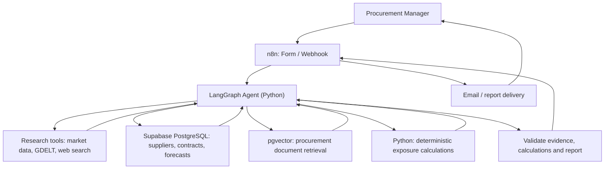

# Solution Architecture — Procurement Risk & Mitigation Agent

**Project:** Ironhack AI Consulting Bootcamp · Project 3  
**Company:** Bakery Foods Inc. (fictional bakery manufacturer)  
**Scope:** Four-day MVP prototype  
**Status:** Proposed architecture; implementation and test results to be documented separately

## 1. Architecture at a glance

The system turns an on-demand procurement question into a research-backed risk report. **LangGraph (Python) is the primary agent orchestrator.** n8n is a thin entry and delivery layer, not a second reasoning engine.

The model interprets evidence and drafts recommendations. **SQL and Python supply factual records and calculations. Procurement decisions remain human-owned.**

## 2. Component responsibilities

| Component | Responsibility | Design rationale |
|---|---|---|
| **LangGraph + Python** | Manage research state, choose tools, assess evidence gaps, stop research, and assemble the report | One primary orchestration layer with explicit workflow control |
| **OpenAI API** | Interpret requests and evidence; draft report sections; create embeddings for document retrieval | Language understanding and synthesis, not financial authority |
| **External research integrations** | Retrieve commodity benchmarks, relevant news, and supplier candidate information | Bring current outside evidence into the assessment |
| **Supabase PostgreSQL** | Store fictional suppliers, contracts, forecasts, and structured assessment records | Exact queries for structured procurement data |
| **pgvector + document chunks** | Retrieve relevant fictional policies and supplier assessments | Semantic search for unstructured internal knowledge |
| **Python calculation functions** | Compute exposure scenarios from validated inputs and stated assumptions | Reproducible, testable financial logic |
| **n8n** | Accept the request, call the agent service, route status, and deliver the report | Simple business workflow automation without duplicating agent logic |

**MCP decision:** If feasible after the core workflow is working, connect **one web-research tool via MCP** to demonstrate standardized tool access. Other integrations can use direct Python APIs. MCP is optional for this MVP; it does not improve the model's reasoning by itself.

## 3. End-to-end workflow

1. **Request:** The manager selects an ingredient and time horizon (for example, sunflower oil over three months). n8n validates required fields and calls the Python agent service.
2. **Plan and research:** LangGraph identifies information needs and calls appropriate external tools. The research loop is bounded by iteration, tool-call, and time limits.
3. **Internal context:** SQL retrieves relevant suppliers, contracts, and forecasts. Vector search retrieves relevant procurement policy or supplier-document passages.
4. **Evidence review:** The agent checks relevance, publication dates, source references, and gaps. It can request more research within the defined budget.
5. **Exposure calculation:** Python calculates scenario-based cost impact using available contract/forecast inputs and explicitly labeled price assumptions. Missing essential inputs produce an unavailable result, not an invented figure.
6. **Mitigation options:** The agent compares approved suppliers and may identify up to three **unverified** external supplier candidates for follow-up.
7. **Report validation and delivery:** Required sections, calculation outputs, and source references are checked. n8n sends the completed or clearly labeled partial report; failures trigger notification.

**Example output:** A single *Procurement Risk Assessment & Mitigation Strategy Report* with executive summary, evidence, supplier exposure, financial scenarios, mitigation options, uncertainties, and decisions requiring approval.

## 4. Data and retrieval design

| Data | Storage / access | Important boundary |
|---|---|---|
| Fictional suppliers, contracts, and demand forecasts | PostgreSQL tables, queried with read-only SQL | Structured records are not generated by the LLM |
| Fictional procurement policies and supplier assessments | Document chunks and embeddings in PostgreSQL + pgvector | Retrieved passages are supporting context, not automatic proof of current supplier compliance |
| Commodity benchmarks | External source or periodically loaded dataset | Benchmark movements are not actual supplier contract prices |
| News and disruption signals | External API/search results | Preserve source, date, and uncertainty; filter irrelevant signals |
| New supplier candidates | External search evidence | Discovery is not qualification, capacity confirmation, or approval |

**External sources under consideration:** World Bank Pink Sheet commodity data, GDELT news data, and Tavily web search. Their coverage, API access, pricing, and suitability for sunflower oil must be checked during implementation. A source that lacks the required commodity or timely evidence should be replaced or excluded, not treated as validated.

## 5. AI, rules, and human responsibilities

| AI-assisted | Deterministic / system-controlled | Human-owned |
|---|---|---|
| Research planning and tool selection | Request validation and access permissions | Approve mitigation actions |
| News relevance and evidence synthesis | SQL retrieval and financial formulas | Qualify and approve new suppliers |
| Drafting risk assessments and options | Output schemas, research budgets, retries | Confirm quotes, capacity, and contract changes |
| Identifying unresolved questions | Status routing and delivery controls | Decide whether and when to purchase |

The agent has **no purchasing or supplier-approval tool**. It must not represent assumptions as verified facts.

## 6. MVP operating boundaries

- **Ingredient coverage:** Sunflower oil end-to-end; a second ingredient if time permits.
- **Internal dataset:** Approximately five fictional suppliers, five contracts, and three months of forecasts.
- **Research limits:** A small bounded loop (for example, at most three research rounds), plus API and execution limits.
- **Failure handling:** Retry temporary external failures; report evidence gaps; stop calculations that lack required data; notify on unrecoverable errors.
- **Delivery:** n8n sends reports or failure notifications without performing the underlying analysis.
- **Security:** Synthetic data only; credentials stored outside source control; read-only database access for the agent.

The prototype is **not** a production procurement platform. Real ERP integration, continuous alerts, supplier qualification, comprehensive monitoring, and deployment governance are future work.

## 7. Implementation priorities and proof

| Priority | Deliverable |
|---|---|
| **1 — Working vertical slice** | One sunflower oil request → research + internal data → calculated scenarios → report |
| **2 — Reliable output** | Source references, explicit assumptions, report schema, missing-data handling |
| **3 — Integration** | n8n trigger and delivery; RAG and external tool connections |
| **4 — Portfolio evidence** | Two sample reports, workflow diagram, reproducible setup, and selected failure-test results |
| **Optional** | One MCP-enabled research integration, only if it does not threaten the core workflow |

For evaluation criteria, detailed error-handling rules, LLM-as-a-Judge, and test evidence, see `03-ai-workflow-evaluation.md`.

---

*Portfolio disclosure: Bakery Foods Inc. and internal procurement records are fictional. External sources and any live results should be identified and dated. This document describes the proposed design, not verified implementation.*
