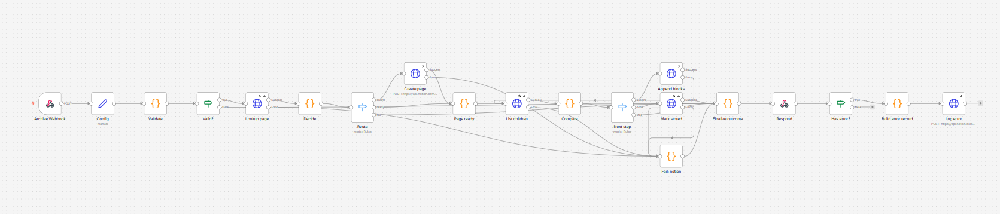
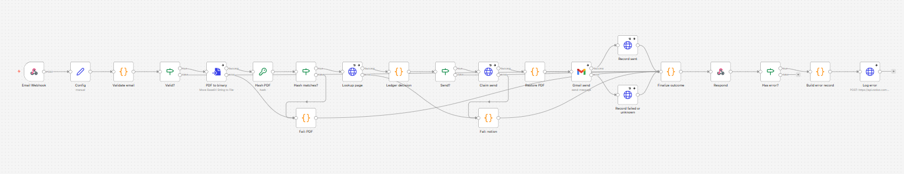

# Procurement Risk & Mitigation Agent

AI-assisted procurement risk intelligence for an industrial bakery (Spain). A **LangGraph** agent researches the market, reads internal contracts and policies, calculates exposure deterministically and writes an evidence-backed risk and mitigation report. **n8n** archives the report in Notion and can e-mail it.

> **Demo recording:** [Loom walkthrough](https://www.loom.com/share/3f1675d6e96b41f098145668226c3a26) *(link supplied by the author; confirm it opens without logging in before submitting)*
> **Slides:** `presentation/project3_slides.pdf` *(placeholder: not added yet)*
> **Sample report (PDF, live PARTIAL run of 13 Nov):** [examples/procurement-risk-assessment-ui-20261113-015628-ccc371.pdf](examples/procurement-risk-assessment-ui-20261113-015628-ccc371.pdf)
> **n8n workflows:** [archive](docs/screenshots/n8n-archive-workflow.png) · [e-mail](docs/screenshots/n8n-email-workflow.png)

**Decision support only.** The agent never approves suppliers, places orders or changes contracts. Bakery Foods Inc., its suppliers, contracts and forecasts are **fictional** and are labelled as such in every report; market data and research are real.

- Why this stack: [stack_decision.md](stack_decision.md) · Next steps after the MVP: [gtm_future_sprints.md](gtm_future_sprints.md)

---

## 1. Business problem and user

Sunflower oil and wheat prices move with weather, geopolitics and supplier constraints. A **raw-material procurement manager** has to connect a market headline to the company's own contracts and forecast to know whether it matters: *what changed, how much of our volume is exposed, and which mitigation actions deserve human review?* Doing that by hand across news, price files, contracts and policy documents is slow and easy to get wrong.

## 2. What the MVP does

Trigger → research and tools → structured report:

1. **Trigger:** the user picks a commodity and a horizon (1–6 months) in the Gradio app (or runs the CLI).
2. **Internal data:** read-only SQL for contracts, forecasts and suppliers; a commodity price benchmark; policy passages retrieved with pgvector (RAG).
3. **Research:** Tavily and GDELT, bounded to 3 rounds with fixed tool-call and time budgets.
4. **Calculation:** fixed, index-linked and uncovered volume and a price-shock sensitivity, in Python with `Decimal` (the LLM never does arithmetic).
5. **Drafting and validation:** the LLM drafts; code validates. Every finding declares its basis, external claims need a verbatim quote from a retained source, and unsupported claims are **removed visibly**.
6. **Report:** a 17-section Markdown report and an 8-page PDF, with status `completed`, `partial` or `failed`.
7. **Delivery (via n8n):** a completed or partial report is archived in Notion automatically; the e-mail with the PDF is sent only when the user clicks.

**Limitations (read before relying on any output)**

- Only **sunflower oil** is functional. Wheat Flour, Granulated Sugar and Butter appear in the dropdown as placeholders and are refused.
- Company data is synthetic. Exposure comes from synthetic contracts and a market benchmark, **not** from any real company's revenue.
- The benchmark is not a supplier quote; crude oil is not refined oil.
- GDELT is an optional source and often returns HTTP 429 or no articles; reports then rely on Tavily and say so.
- Alternative-supplier leads are real companies found by search, shown as **UNVERIFIED** with attributes only when a source states them.
- Most live runs so far ended **PARTIAL** (unsupported items removed by validation), which is the intended behaviour.
- Running the agent needs a populated PostgreSQL database (even in mock mode). There is no database-free demo.

## 3. Architecture

```text
User (Gradio, 127.0.0.1)                       n8n (secondary stack)
        |                                              ^
        v                                              | HTTPS webhook + X-Webhook-Secret
AppController (src/ui) ------ run ------> LangGraph agent (src/agent)
        |                                   |-- load_internal: Postgres (read-only, parameterised SQL)
        |                                   |-- calculate: Decimal exposure engine (src/calculations)
        |                                   |-- policy RAG: pgvector (src/rag)
        |                                   |-- search: Tavily + GDELT (src/tools)
        |                                   |-- filter_evidence -> draft (OpenAI) -> validate / prune
        |                                   v
        |                          report.md + status (completed | partial | failed)
        |
        +--> PDF (src/bridge/pdf.py) --> archive webhook --> Notion page (verified)
                                    \--> email webhook (on click) --> Gmail, PDF attached
```

LangGraph owns all analysis. n8n holds no analysis, LLM logic or database access, and never starts an assessment. Details: [docs/02-solution-architecture.md](docs/02-solution-architecture.md) and [docs/day4-architecture.md](docs/day4-architecture.md).

## 4. Tools and APIs

| Tool / API | Used for |
|---|---|
| **OpenAI** (LLM + `text-embedding-3-small`) | Evidence screening, drafting, policy embeddings |
| **Tavily Search** | Market-risk research and alternative-supplier discovery |
| **GDELT DOC 2.0** | News signals (optional source) |
| **Supabase PostgreSQL + pgvector** | Contracts, forecasts, benchmark prices, policy chunks |
| **European Commission oilseeds prices (XLSX)** | Sunflower-oil benchmark, ingested into Postgres |
| **n8n + Notion + Gmail** | Report archive and optional e-mail |
| LangGraph, Gradio, FastAPI, fpdf2, Pydantic, pytest | Orchestration, UI, assessment API, PDF, validation, tests |

Deferred and not built: FRED, MCP, LLM-as-a-Judge, public-risk monitoring of existing suppliers.

## 5. Setup

Requirements: **Python 3.13**, a Supabase (PostgreSQL with `pgvector`) project, and for live runs an OpenAI key and a Tavily key.

```bash
python -m venv .venv
.venv\Scripts\activate            # Windows; on macOS/Linux: source .venv/bin/activate
pip install -r requirements.txt
cp .env.example .env              # then edit .env (never commit it)
python -m src.bridge.fonts --fetch   # downloads DejaVu fonts (SHA-256 checked) for the PDF
```

### Environment variables (names only; real values go in the git-ignored `.env`)

| Variable | Needed for |
|---|---|
| `DATABASE_URL` | Every run (Supabase session-pooler URI; the agent only reads) |
| `OPENAI_API_KEY`, `OPENAI_MODEL` | Live runs and policy embeddings |
| `TAVILY_API_KEY` | Live runs |
| `OPERATING_MARKET` | Optional (default Spain) |
| `ALLOW_PAID_CALLS` | Set to `1` in the **process** that is allowed to make paid calls |
| `LIVE_BUDGET_USD`, `OPENAI_REASONING_EFFORT` | Optional budget limit (default USD 5) and reasoning effort |
| `N8N_ARCHIVE_WEBHOOK_URL`, `N8N_EMAIL_WEBHOOK_URL`, `N8N_WEBHOOK_SECRET` | Archive and e-mail through n8n (HTTPS URLs; secret sent as `X-Webhook-Secret`) |
| `PDF_FONT_DIR` | Optional font folder override |
| `ASSESSMENT_API_KEY`, `ASSESSMENT_STORE_DIR`, `ASSESSMENT_DEADLINE_SECONDS` | Optional FastAPI service only |

### Database (one-time; these commands write to your own database)

```bash
python -m src.db.migrate                 # dry run; add --apply to create the schema (sql/001_schema.sql)
python -m src.ingestion.load_synthetic   # dry run; add --apply to load the synthetic CSVs
python -m src.ingestion.ec_oilseeds      # dry run; needs data/raw/European_Commission_Oilseeds_Prices.xlsx (see data/raw/MANIFEST.md); add --apply
python -m src.rag.load_policies          # dry run; --apply loads the policy chunks, --apply then --embed embeds them (paid; needs ALLOW_PAID_CALLS=1)
```

All pipelines are dry-run by default and idempotent. The EC workbook is third-party data and is **not** in the repository.

## 6. Run it

**Offline tests (no network, no paid calls):**

```bash
python -m pytest tests -q
```

**Mock mode** (fixture research and template text; real read-only database data; no paid call):

```bash
python -m src.ui.gradio_app --mock         # then open http://127.0.0.1:7860
python -m src.agent.run --mock             # CLI; writes runs/local-001.md
```

**Live mode** (real Tavily, GDELT and OpenAI; paid). Authorization controls:

- It runs only in a process that has `ALLOW_PAID_CALLS=1`; otherwise it is refused before any external call.
- It is refused when `OPENAI_API_KEY`, `OPENAI_MODEL`, `TAVILY_API_KEY` or `DATABASE_URL` is missing.
- A budget guard blocks the run once logged spend (`runs/usage.jsonl`) would exceed `LIVE_BUDGET_USD` (default USD 5); a 40,000-token cap applies per run.
- The Gradio app allows one paid run per launch (`--max-live-runs`).
- If research cannot run, the run fails visibly. It never falls back to fixtures.

```powershell
$env:ALLOW_PAID_CALLS="1"
python -m src.ui.gradio_app                 # open http://127.0.0.1:7860 and press Run Assessment
python -m src.agent.run --live              # CLI equivalent
```

The app binds to `127.0.0.1` only (no share link, no analytics). Start the optional assessment API with `python -m uvicorn src.api.app:create_app --factory --host 127.0.0.1 --port 8000` (needs `ASSESSMENT_API_KEY`; mock mode only).

## 7. n8n integration

1. Import `n8n/procurement-report-archive.json` and `n8n/procurement-report-email.json` into your n8n.
2. Create the Notion databases from [docs/notion-database-schemas.md](docs/notion-database-schemas.md); fill the placeholders in each workflow's `Config` node (database ids; for the e-mail workflow, the recipient).
3. Create a **Header Auth** credential (header `X-Webhook-Secret`) and attach it to both webhooks; add your Notion and Gmail credentials.
4. Publish the workflows and put their **Production** URLs and the same secret in `.env` (`N8N_ARCHIVE_WEBHOOK_URL`, `N8N_EMAIL_WEBHOOK_URL`, `N8N_WEBHOOK_SECRET`).





The screenshots show the workflow canvases (no executions). The exports contain no credentials. See [n8n/README.md](n8n/README.md) for the workflow list.

## 8. File map

| Path | Purpose |
|---|---|
| `src/agent/` | LangGraph workflow (`graph.py`), prompts, evidence validation, report rendering, live controls (`run.py`, `budget.py`, `live_record.py`) |
| `src/calculations/` | Deterministic exposure engine (`Decimal`) |
| `src/rag/`, `src/db/`, `sql/` | Policy chunking, embeddings and retrieval; migrations and SQL guard; schema |
| `src/ingestion/`, `src/synthetic/`, `data/synthetic/` | EC benchmark ingestion; validated synthetic company data and policy documents |
| `src/tools/` | Tavily and GDELT wrappers |
| `src/ui/` | Gradio app and controller |
| `src/bridge/` | Webhook client for n8n, payload builder, PDF exporter, font installer |
| `src/api/` | Optional FastAPI assessment service (mock mode only) |
| `n8n/` | Workflow exports and the script that generates them |
| `tests/` | Offline test suite (mocked services; an in-process n8n/Notion simulator) |
| `docs/` | Business case, architecture, evaluation, implementation records (see below) |
| `stack_decision.md`, `gtm_future_sprints.md` | Submission deliverables |
| `examples/`, `docs/screenshots/` | Sample report PDF; n8n workflow canvases |
| `runs/` (git-ignored) | Local reports, live run records and `usage.jsonl` |
| `CLAUDE.md` | Project rules and safety boundaries |

**Documentation:** [01-business-case](docs/01-business-case.md) · [02-solution-architecture](docs/02-solution-architecture.md) · [03-ai-workflow-evaluation](docs/03-ai-workflow-evaluation.md) · [implementation-plan](docs/implementation-plan.md) · [day4-architecture](docs/day4-architecture.md) (sections 19–25: Gradio, n8n, PDF, live runs) · [notion-database-schemas](docs/notion-database-schemas.md) · [api-specification](docs/api-specification.md).

## 9. Verified status

Statuses mean: **tested offline** = automated tests pass with mocked services; **run live** = executed against the real service with evidence in `runs/` (local, not committed); **not verified** = no evidence in this repository.

| Area | Status |
|---|---|
| Agent, calculations, validation, RAG logic, PDF, bridge client, Gradio controller | Tested offline: 1250 tests passed, 45 opt-in database tests skipped (13 Nov 2026) |
| Supabase data (synthetic data, 308 EC benchmark observations, 25 policy chunks with embeddings) | Loaded and read live; policy retrieval checked against real pgvector |
| Live assessments (Tavily + GDELT + OpenAI, gpt-5.4-mini) | Run live on 10, 11 and 13 Nov. Eight Gradio runs on 13 Nov are recorded (1 failed before a validation fix, 1 completed, 6 partial); each cost about USD 0.04, cumulative estimate USD 0.55 of the USD 5 limit. GDELT often unavailable |
| Notion archive and Gmail e-mail through n8n | Exercised by the project owner against real Notion and Gmail during integration (archive verified, e-mail received). Screenshots and execution exports are **not** in the repository |
| `ops.operational_events` log (migration `002`) | **Planned, not built.** Draft SQL only in `sql/drafts/` |
| FastAPI service | Offline tests and a local mock-mode run; live mode not wired |
| Business validation, user feedback, accuracy, ROI | **None yet** (see [gtm_future_sprints.md](gtm_future_sprints.md)) |

No accuracy, time-saving or ROI claim is made.

## Disclaimer

Bakery Foods Inc. and its internal procurement records are fictional. This is an experimental decision-support prototype, not a procurement system. External sources may be incomplete or outdated; supplier candidates need independent qualification. Financial figures are scenarios built from the stated inputs. All procurement decisions need human review and approval.
